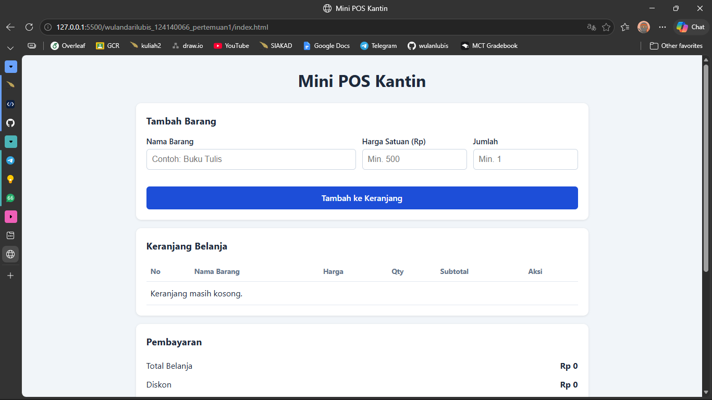
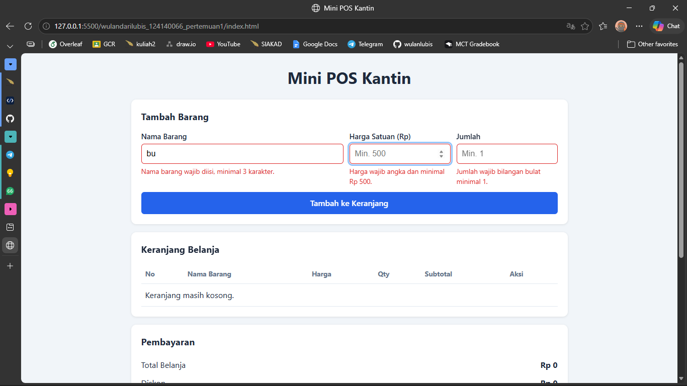
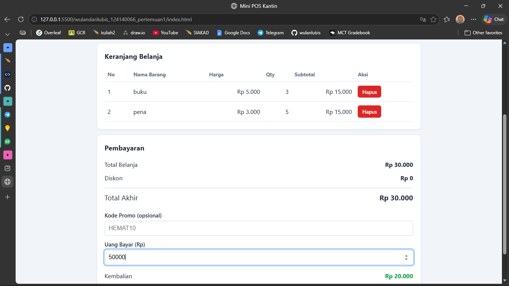

# Mini POS Kantin

## Identitas
- **Nama Lengkap**: Wulandari Lubis
- **NIM**: 124140066
- **Kelas Praktikum**: RA

## Deskripsi Aplikasi
Mini POS Kantin adalah aplikasi web kasir sederhana untuk kantin atau toko kampus. Kasir dapat memasukkan barang belanjaan, melihat daftar belanja, menghitung total dan diskon otomatis, lalu menghitung kembalian. Isi keranjang disimpan di `localStorage` sehingga tidak hilang saat halaman di-refresh.

Tujuan pembuatan: mempraktikkan validasi input form, perhitungan otomatis dengan JavaScript, dan manajemen data berbasis `localStorage`.

Studi kasus: kasir kantin / toko kampus.

## Cara Menjalankan
1. Clone repository ini.
2. Buka folder proyek di VS Code.
3. Pasang ekstensi **Live Server**.
4. Klik kanan `index.html`, lalu pilih **Open with Live Server**.
5. Aplikasi terbuka di browser (biasanya `http://127.0.0.1:5500`).

## Daftar Fitur
- ✅ Validasi nama barang (wajib, minimal 3 karakter)
- ✅ Validasi harga satuan (angka, minimal Rp 500)
- ✅ Validasi qty (bilangan bulat, minimal 1)
- ✅ Pesan error berwarna merah di bawah input yang salah
- ✅ Form otomatis di-reset setelah barang berhasil ditambahkan
- ✅ Subtotal per barang (harga x qty) dan total belanja otomatis
- ✅ Diskon 10% untuk belanja minimal Rp 50.000 atau kode promo `HEMAT10`
- ✅ Kalkulator uang bayar dan kembalian (ada keterangan jika uang kurang)
- ✅ Tombol Hapus per item dengan perhitungan ulang otomatis
- ✅ Penyimpanan keranjang di `localStorage` (`JSON.stringify` / `JSON.parse`)
- ✅ Tombol Transaksi Baru untuk mengosongkan keranjang dan `localStorage`
- ✅ Tampilan responsif dan format Rupiah

## Tangkapan Layar
**1. Tampilan form input utama**

**2. Tampilan saat validasi error muncul**

**3. Tampilan hasil perhitungan dan tabel keranjang**

## Penjelasan Teknis Singkat
**Validasi input.** Fungsi `validasiForm()` membaca nilai ketiga input. Nama dicek dengan `trim()` dan panjang minimal 3. Harga dan qty dibaca dengan `valueAsNumber` (input kosong menjadi `NaN`), lalu dicek harga >= 500 dan qty bilangan bulat >= 1. Jika ada yang salah, pesan merah ditampilkan di bawah input dan barang tidak ditambahkan.

**Kalkulator.** Subtotal dihitung `harga x qty` per baris. Total belanja dihitung dengan `reduce()` yang menjumlahkan semua subtotal. Diskon 10% diberikan jika total >= Rp 50.000 atau kode `HEMAT10` dimasukkan. Total akhir = total - diskon, dan kembalian = uang bayar - total akhir.

**LocalStorage.** Array `keranjang` diubah menjadi string dengan `JSON.stringify()` lalu disimpan lewat `localStorage.setItem()`. Saat halaman dibuka, data diambil dengan `localStorage.getItem()` dan diubah kembali menjadi array dengan `JSON.parse()`. Fungsi `perbarui()` dipanggil setiap keranjang berubah supaya penyimpanan, tabel, dan perhitungan selalu sinkron.