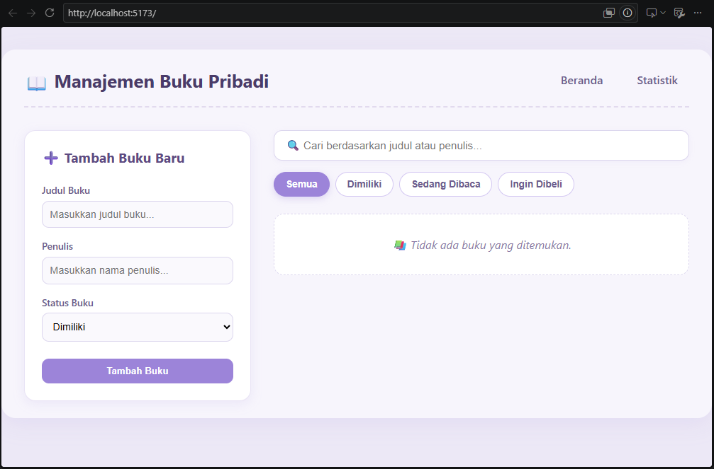
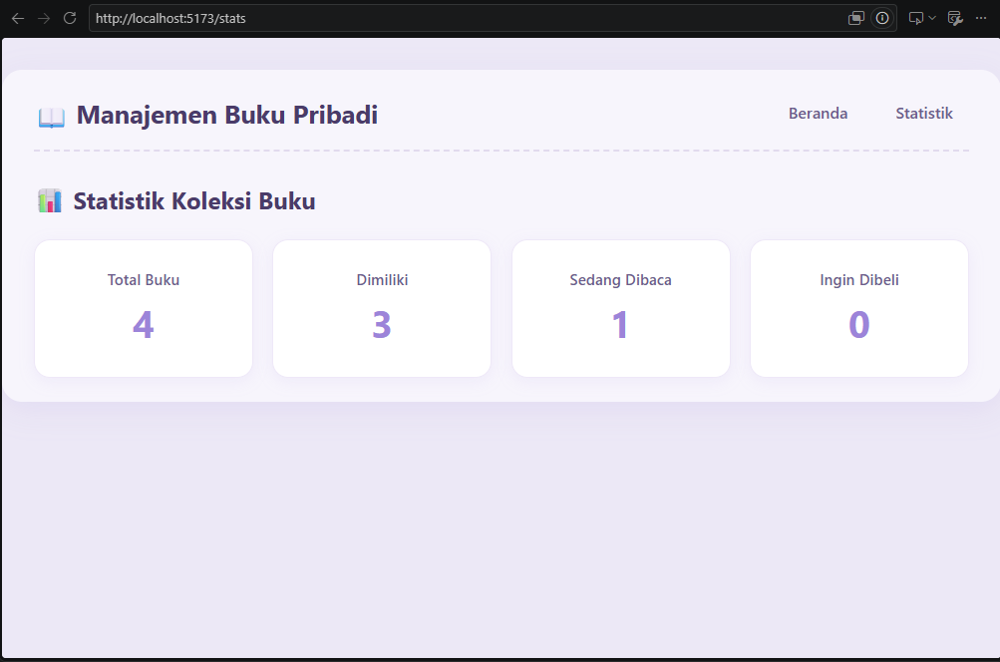
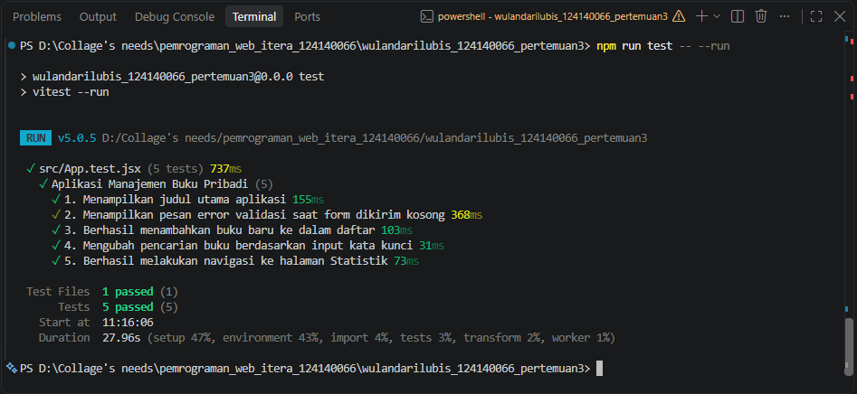

# Manajemen Buku Pribadi

Aplikasi web untuk mencatat koleksi buku pribadi dengan status **Milik**, **Sedang Dibaca**, atau **Ingin Dibeli**. Dibuat dengan React (Vite) dan tema pastel purple.

## Fitur
- Tambah, edit, dan hapus buku (judul, penulis, status)
- Filter berdasarkan status dan pencarian judul/penulis
- Validasi form: input kosong menampilkan pesan error dan border merah
- Data tersimpan otomatis di `localStorage`
- Halaman statistik jumlah buku per status

## Cara Menjalankan
```bash
cd wulandarilubis_124140066_pertemuan3
npm install
npm run dev     # jalankan aplikasi
npm run test    # jalankan unit test
```

## Screenshot hasil
| Home | Statistik |
|------|-----------|
|  |  |

## Fitur React yang Digunakan
- **useState & useEffect**: state form, filter, pencarian, dan sinkronisasi ke `localStorage`
- **Custom hooks**: `useLocalStorage` (persistensi data) dan `useBookStats` (hitung statistik)
- **Context API**: `BookContext` menyimpan daftar buku dan fungsi tambah/edit/hapus
- **React Router**: halaman `Home` (`/`) dan `Stats` (`/stats`)
- **Komponen reusable**: `BookForm`, `BookList`, `BookFilter`
- **PropTypes**: validasi props di semua komponen

## Laporan Testing
Menggunakan Vitest + React Testing Library (5+ test).


