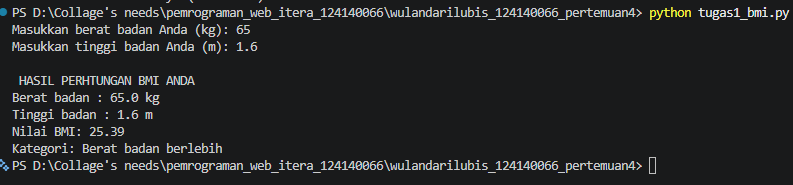
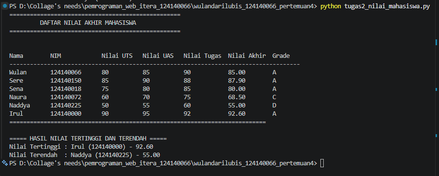
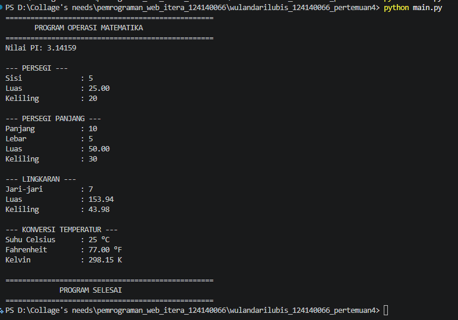

# Tugas Praktikum Pemrograman Python - Pertemuan 4

## Identitas Mahasiswa

- Nama: Wulandari Lubis
- NIM: 124140066
- Kelas: RA

---

## Deskripsi Program

### 1. Program Penghitung BMI

File: `tugas1_bmi.py`

Program ini digunakan untuk menghitung nilai Body Mass Index (BMI)
berdasarkan berat badan dan tinggi badan yang dimasukkan oleh pengguna.

Program menggunakan:
- Variabel untuk menyimpan berat dan tinggi badan.
- Input untuk menerima data dari pengguna.
- Operator aritmatika untuk menghitung BMI.
- Percabangan if-elif-else untuk menentukan kategori BMI.
- F-string untuk menampilkan hasil perhitungan.

### 2. Program Pengelolaan Data Nilai Mahasiswa

File: `tugas2_nilai_mahasiswa.py`

Program ini digunakan untuk mengelola data nilai mahasiswa
dan menghitung nilai akhir berdasarkan bobot UTS, UAS, dan tugas.

Program menggunakan:
- List untuk menyimpan data mahasiswa.
- Dictionary untuk menyimpan identitas dan nilai mahasiswa.
- Perulangan for untuk memproses data.
- Percabangan if-elif-else untuk menentukan grade.
- Fungsi max() dan min() untuk mencari nilai tertinggi
  dan terendah.
- F-string untuk menampilkan data dalam bentuk tabel.

### 3. Modul Matematika Python

File:
- `math_operations.py`
- `main.py`

Program ini menggunakan konsep modularitas Python dengan
memisahkan kumpulan fungsi matematika ke dalam sebuah modul.

Modul math_operations.py berisi:
- Konstanta PI.
- Fungsi luas dan keliling persegi.
- Fungsi luas dan keliling persegi panjang.
- Fungsi luas dan keliling lingkaran.
- Fungsi konversi Celsius ke Fahrenheit.
- Fungsi konversi Celsius ke Kelvin.

File main.py digunakan untuk mengimpor dan menjalankan
seluruh fungsi yang terdapat dalam modul tersebut.

Program menerapkan dua cara impor, yaitu:
- import math_operations
- from math_operations import ...

---

## Cara Menjalankan Program

Pastikan Python sudah terinstal pada perangkat.

Buka terminal dan masuk ke direktori project.

### Menjalankan Soal 1
```bash
python tugas1_bmi.py
```

### Menjalankan Soal 2
```bash
python tugas2_nilai_mahasiswa.py
```

### Menjalankan Soal 3
```bash
python main.py
```

---

## Dokumentasi Hasil Eksekusi

### Soal 1 - Penghitung BMI



### Soal 2 - Pengelolaan Nilai Mahasiswa



### Soal 3 - Modul Matematika Python



---
