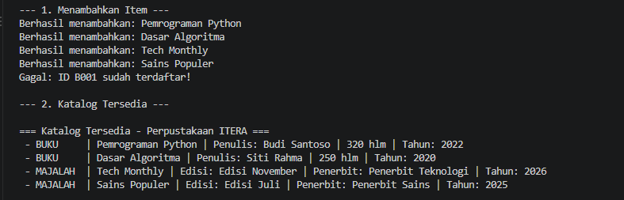
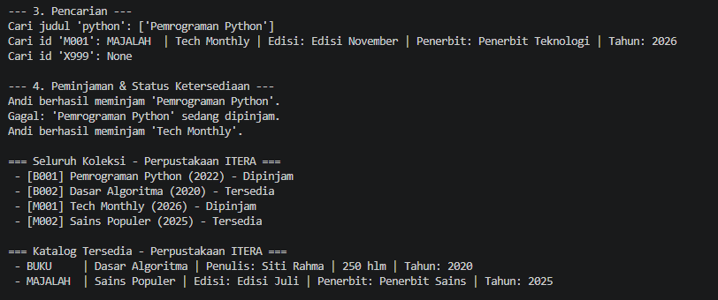
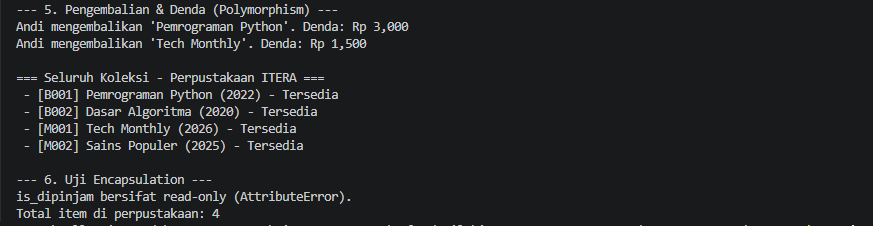

# Tugas Pertemuan 5 - Python OOP: Sistem Manajemen Perpustakaan

## Identitas Mahasiswa

- **Nama Lengkap** : Wulandari Lubis
- **NIM** : 124140066
- **Kelas Praktikum** : RA

## Deskripsi Program

Program ini adalah sistem perpustakaan sederhana. `main.py` membuat objek `Library`, menambahkan beberapa
`Book` dan `Magazine`, menampilkan katalog item yang tersedia, mencari item berdasarkan judul atau id,
lalu mensimulasikan peminjaman dan pengembalian oleh `Member` (termasuk perhitungan denda).

### Penerapan 4 Pilar OOP

1. **Class & Object** - `LibraryItem`, `Book`, `Magazine`, `Member`, dan `Library` dibuat sebagai class,
   lalu diinstansiasi menjadi objek di `main.py`.
2. **Inheritance** - `Book` dan `Magazine` mewarisi `LibraryItem` dan memakai `super().__init__()`
   untuk memanggil constructor parent.
3. **Encapsulation** - `__item_id` dan `__dipinjam` (private) di `LibraryItem`, `__koleksi` (private) di
   `Library`, `__pinjaman` (private) di `Member`, serta `_judul`, `_tahun`, `_penulis` (protected).
   Property `is_dipinjam` bersifat read-only, dan property `tahun` memiliki setter dengan validasi.
4. **Polymorphism** - `hitung_denda()` dan `get_detail()` adalah abstract method yang diimplementasikan
   berbeda oleh `Book` (Rp 1.000/hari) dan `Magazine` (Rp 500/hari). `Library` memanggilnya lewat
   satu antarmuka yang sama tanpa `if-else` per tipe.

### Struktur

```
tugas_perpustakaan/
├── library_item.py   # LibraryItem (abstract), Book, Magazine
├── member.py         # Member
├── library.py        # Library
└── main.py           # Program utama
```

## Cara Menjalankan

```bash
cd tugas_perpustakaan
python main.py
```

## Screenshot Output

> Jalankan `python main.py`, lalu tempel screenshot terminal di sini
> (menampilkan penambahan, pencarian, dan katalog).




